# A7 – [FEA Bracket Design Optimization]

## Objective - 

The objective of this assignment is to use, Finite Element Analysis (FEA) to evaluate and improve the bracket design from Assignment 6.
Ensure high stiffness, high strength, and lightweight optimization through iterative modeling. Conduct multiple FEA simulations 
and refine geometry based on convergence and stress distributions.

## Analyze

The first thing I had to do was make sure I was working with the proper materials, I went to model and simulate and was able to choose the correct option the A1606 as shown below. 

## Change of material 
<figure>
  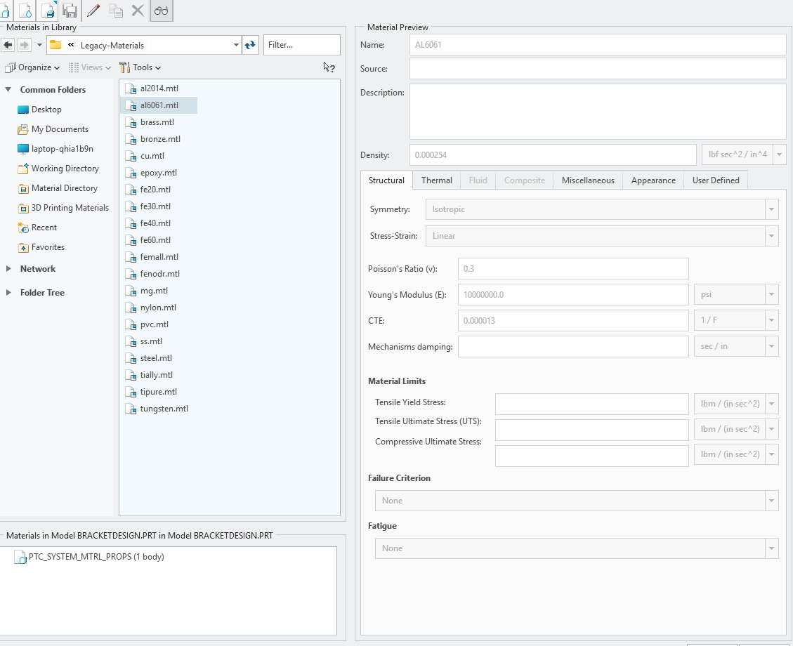
  <figcaption> The first step of changing the material</figcaption>
</figure>

## Inner Loop Setup 
After this to create the proper simulation for the stress and displacement of the inner loop I would need to go to simulate in creo. Then I would need to choose which parts of my bracket were fixed as shown below. 
<figure>
  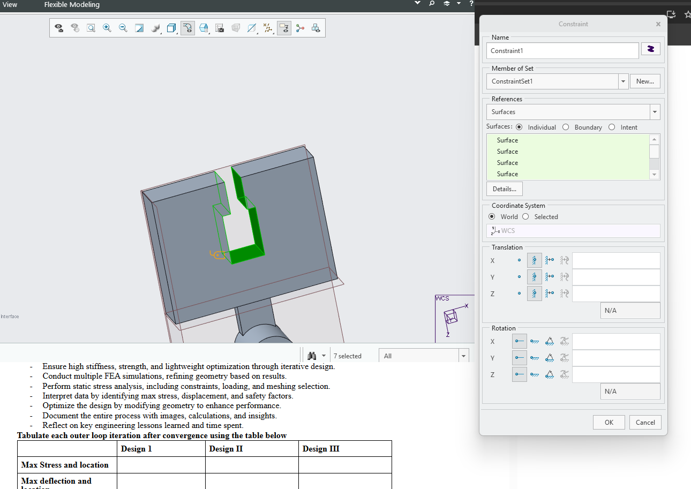
  <figcaption> The step of fixed supports</figcaption>
</figure>

After fixing these parts of the bracket I would set the load of 1200 lbs which was used in my previous a5 and a6 calculations.
I would set this along the pin connection as shown in the image below it was applied to the pin and put on the z axis as that is what 
acted downward in design. 

<figure>
  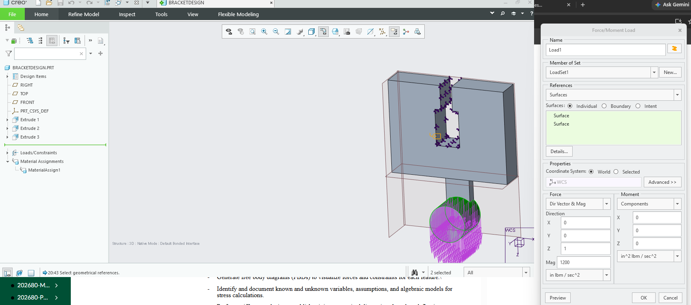
  <figcaption> The step of changing the load applied </figcaption>
</figure>

Next, I would go to AutoGem so I could simulate the elements needed for the first simulation, at first admittedly my baseline was a
bit too small which is a mistake on my part, it was 68 as shown in this first picture which lead to a higher stress and worse outcomes. 

<figure>
  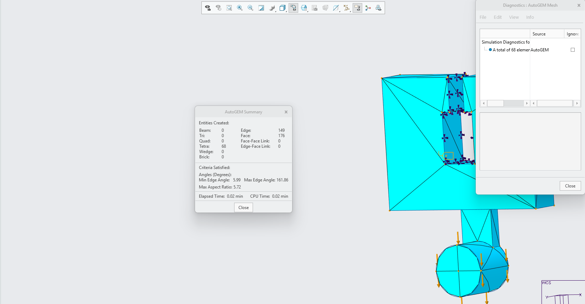
  <figcaption> The step of the bodies elements</figcaption>
</figure>

Now that the bodies were simulated though I could being the inner loop of changing the bodies to see if I could get within a seven 
percent range, of max stress and max deflection. 

<figure>
  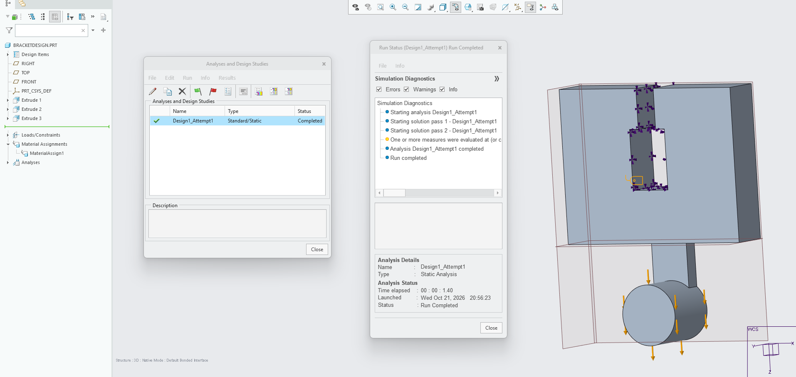
  <figcaption> The step of bodies being simulated </figcaption>
</figure>

## Inner Loop Simulation's and Calculation's, Coarse Baseline

The baseline was already extremely small so the maximum stress climbed way above what would be needed for it to be within a good safety 
factor. The image below is the stress von mises and the maximum deflection. 

<figure>
  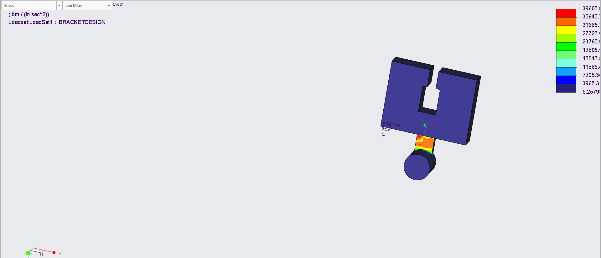
  <figcaption> The stress von mises of design1 run 1 </figcaption>
</figure>

<figure>
  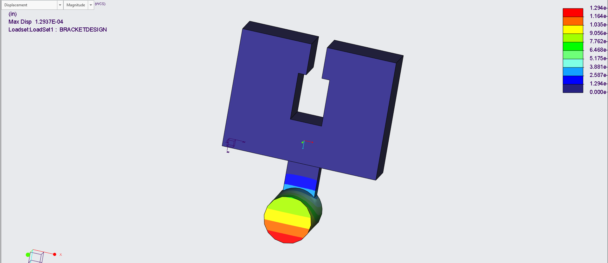
  <figcaption> The deflection of design 1 run 1</figcaption>
</figure>

Seeing this I decided to go back to the simulation tab and change the maximum size of the elements so I could fit more for the next run 
of this first loop and to make sure it could converge to 7%. I started by making the bodies size 0.08 inches as I thought the smaller the 
better for me. 

Here I would have a safety factor of 1.01, but this was due to the fact that I had such a low number of elements so I had to do a finer 
mesh to be sure of it. 

## Inner Loop Part 2 - 9,533 Elements - Refined Mesh
<figure>
  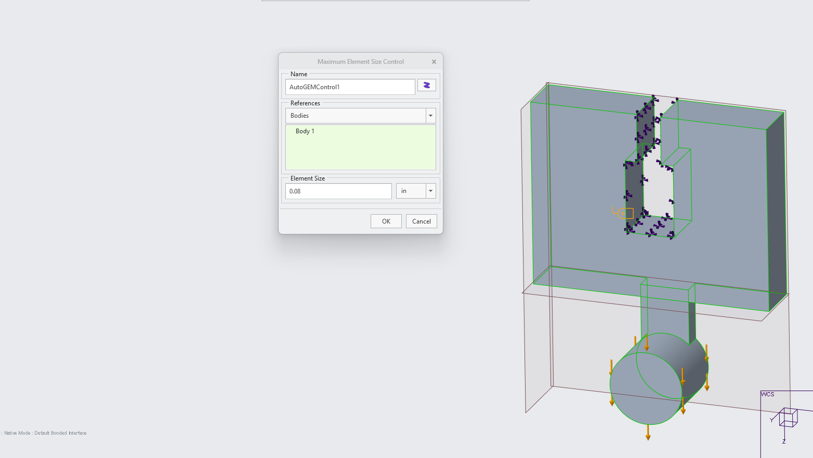
  <figcaption> Changing the size of the elements </figcaption>
</figure>

After doing this I then went back and checked the number of elements in the AutoGem and when I did I realized this number was too low to
be my size as it would take too long to simulate any results below is this number of elements. 

<figure>
  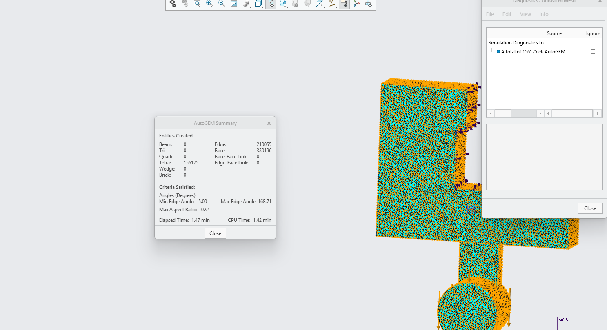
  <figcaption> Absurd number of elements </figcaption>
</figure>

I would go back and change the size of the elements to 0.20 in as shown below it would give me a lower number more fit for the second run 
of my baseline design. 

<figure>
  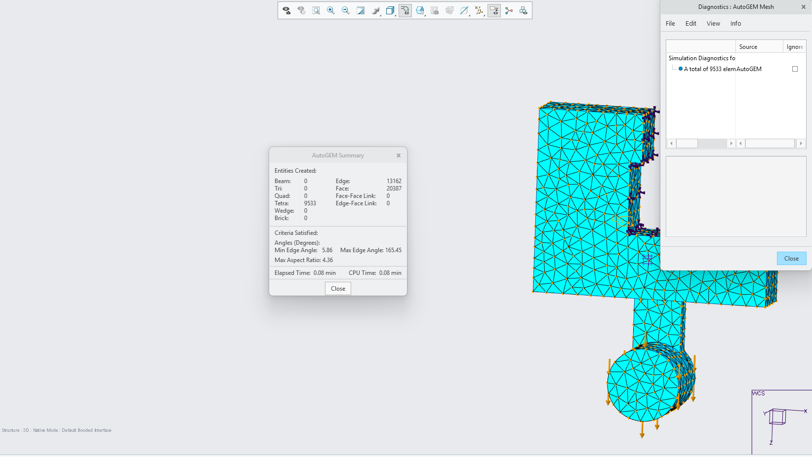
  <figcaption> Checking the number of the elements again </figcaption>
</figure>

I would then run the simulation again naming this one the second attempt of run design_1 as shown below. 
<figure>
  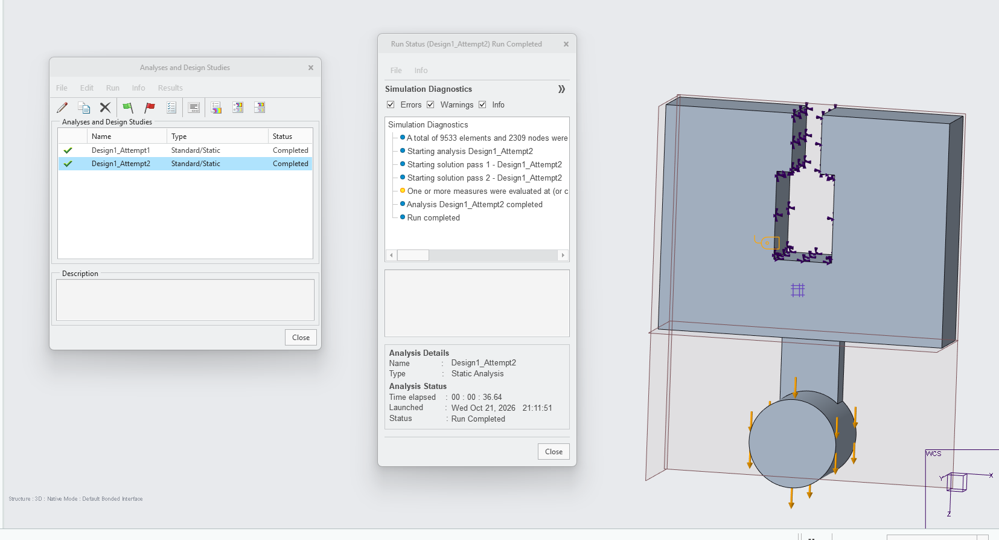
  <figcaption> Showing the second simulation running </figcaption>
</figure>

After this I would check the results of this simulation, so I could compare to the first one and see if I am within the <7% convergence 
required for the inner loop. 

<figure>
  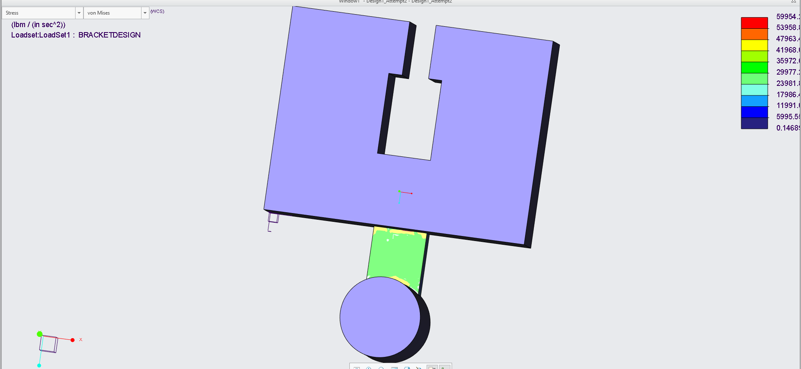
  <figcaption> Showing the second stress von mises</figcaption>
</figure>

<figure>
  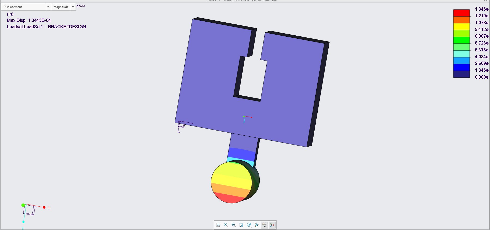
  <figcaption> Showing the second displacement</figcaption>
</figure>

__Calculations and Safety Factor__ 

The difference in displacement convergence in my two simulations would be equal to the displacement of the first minus the second over the first divded by the first displacement times 100%.

% Diff=  
((0.00013445−0.00012937)/0.00013445)×100%=3.78%

I would have a safety factor for this one of 0.67 when I take the absolute value of the A1606 and divided the stress in the simulation. 
By doing 40,000/59,954 I got 0.67 which isn't enough. 

## Inner Loop Third Part Fine Mesh

Because this was well within what was allowed I decided to run the simulation again and see if my second and third displacement converges 
would be closer. I would go back and again change the bodies but this time I would change the element size to be 0.12 as shown below. 

<figure>
  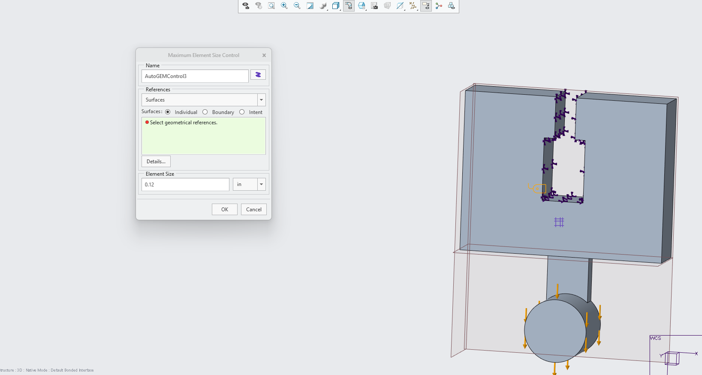
  <figcaption> Showing the third element size to be 0.12</figcaption>
</figure>

Then I would run it again to check and see if it changes by a larger percentage.  
<figure>
  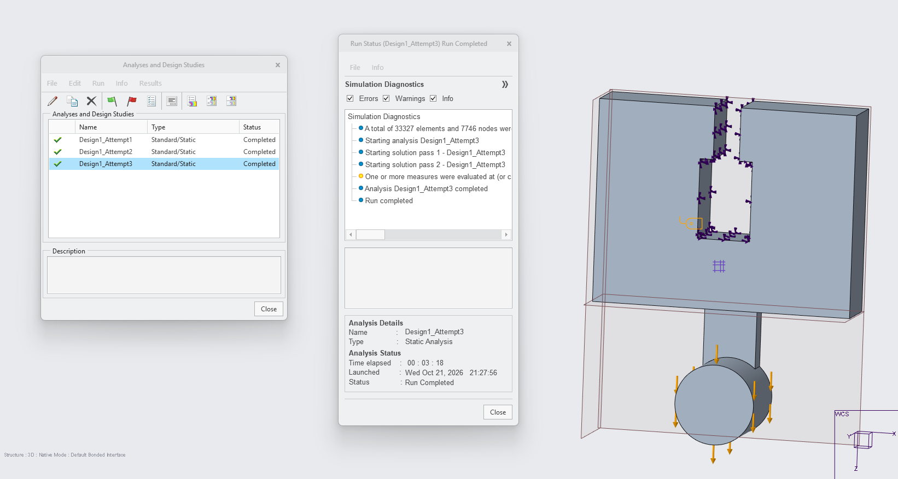
  <figcaption> Showing the third run</figcaption>
</figure>

<figure>
  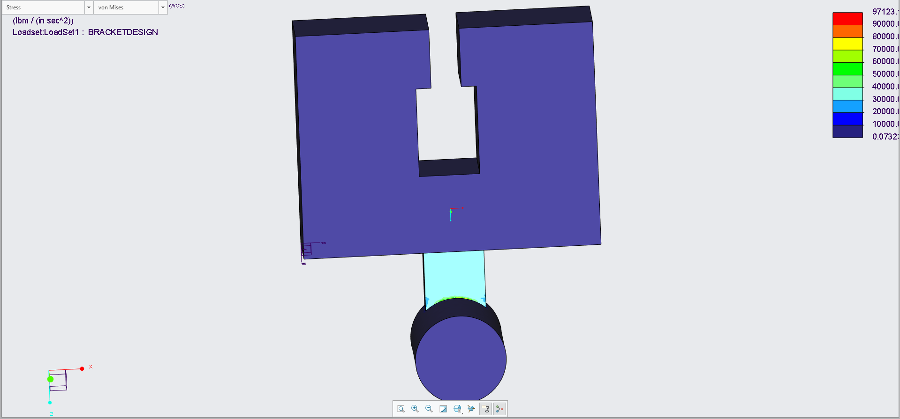
  <figcaption> Showing the third stress von mises</figcaption>
</figure>

<figure>
  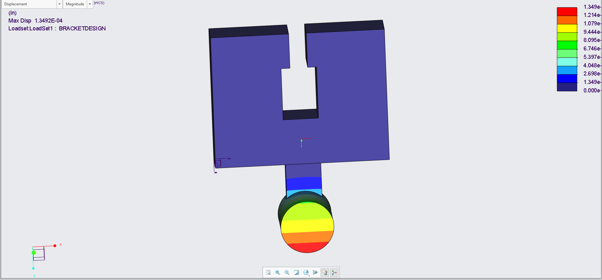
  <figcaption> Showing the third displacement</figcaption>
</figure>

__Calculations and Safety Factor__ 

Again I would have to do the second displacement minus the third displacement over the second displacement times 100 to see how much 
the displacement converged by. 

%Diff = ((0.00013492-0.00013445)/(0.00013492))*100 = 0.35%

I would have a safety factor for this one of 0.41 when I take the absolute value of the A1606 and divided the stress in the simulation. 
By doing 40,000/97,123 I got 0.41 which isn't enough in fact we went down which led to choosing the second mesh. 

## Outer Loop (Geometry Change) Round 1

With my displacement converges done I decided to select the second mesh and move onto my outer loop. I would begin by creating a round 
on my part to cut down some of the maximum stress being applied from the load of 1200 lbs, as shown in the image below. 

<figure>
  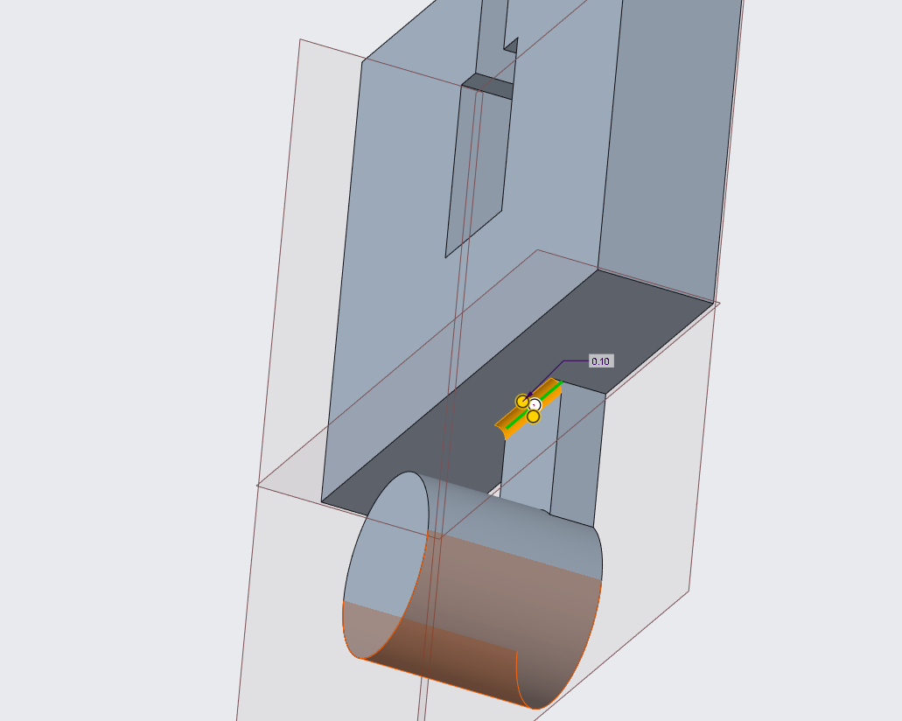
  <figcaption> Showing the round being created</figcaption>
</figure>

After creating the round I would run another simulation on this body as shown below. 
<figure>
  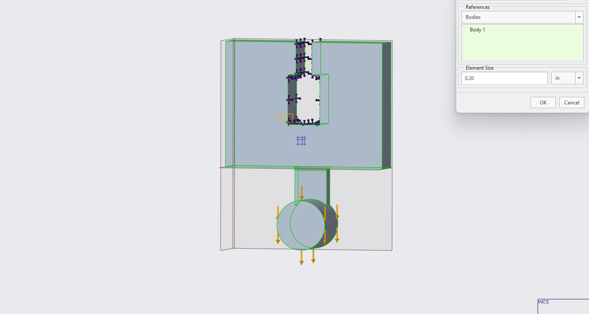
  <figcaption> Showing the simulation being created</figcaption>
</figure>

Then I would view the results and check the amount of stress being applied and see if it fits within at least a safety factor of 1, 
I thought the round may not be enough and as it turns out I was correct. 

<figure>
  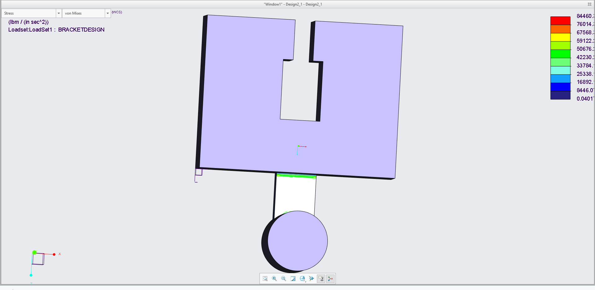
  <figcaption> Showing the high stress </figcaption>
</figure>

Here we can see I still have a roughly 84,000 stress concentration which is still too high. The displacement did decrease though as shown 
below.

<figure>
  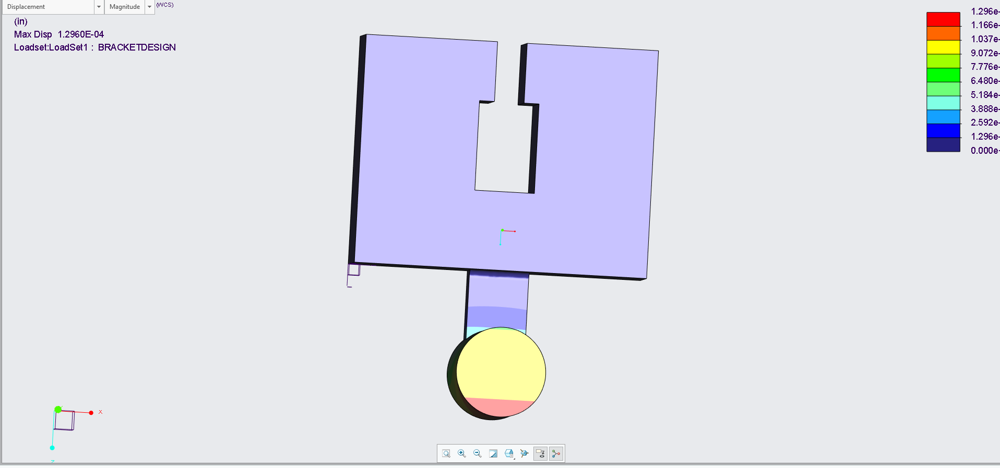
  <figcaption> Showing the displacement </figcaption>
</figure>  

## Outer Loop (Geometry Change) Round 2 

I increased the round to 0.30 as I knew this would be better 

<figure>
  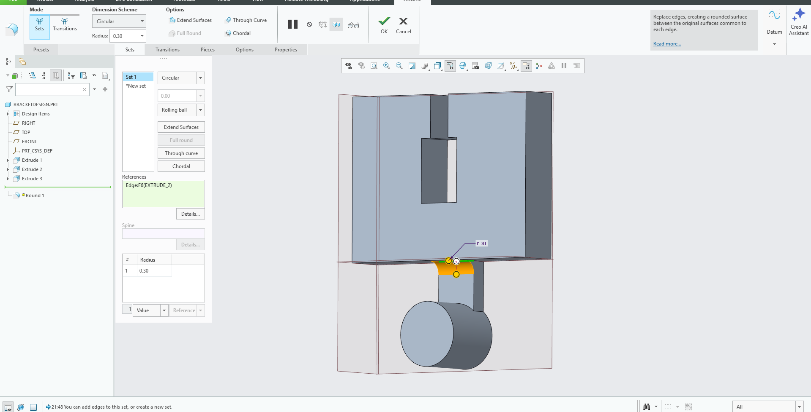
  <figcaption> Showing the next round </figcaption>
</figure>

This would give another high stress knowing it wouldn't work I decided to again increase the length of the round and create a bigger 
thickness. 

## Outer Loop (Geometry Change) Round 3

<figure>
  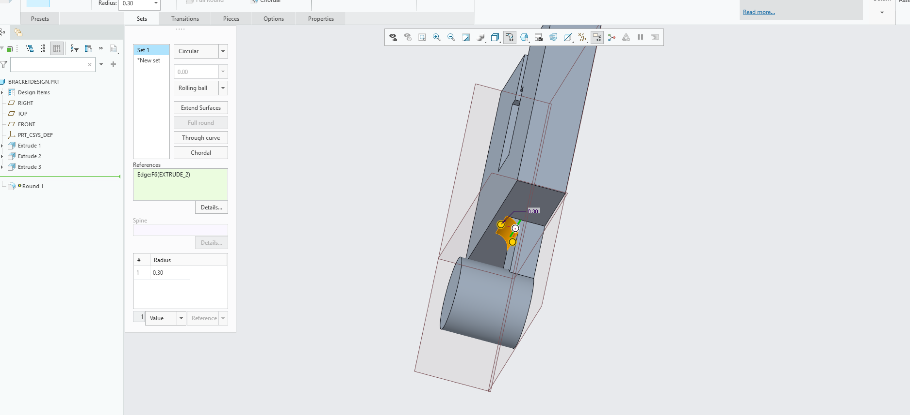
  <figcaption> Showing the next angle of the round </figcaption>
</figure>

<figure>
  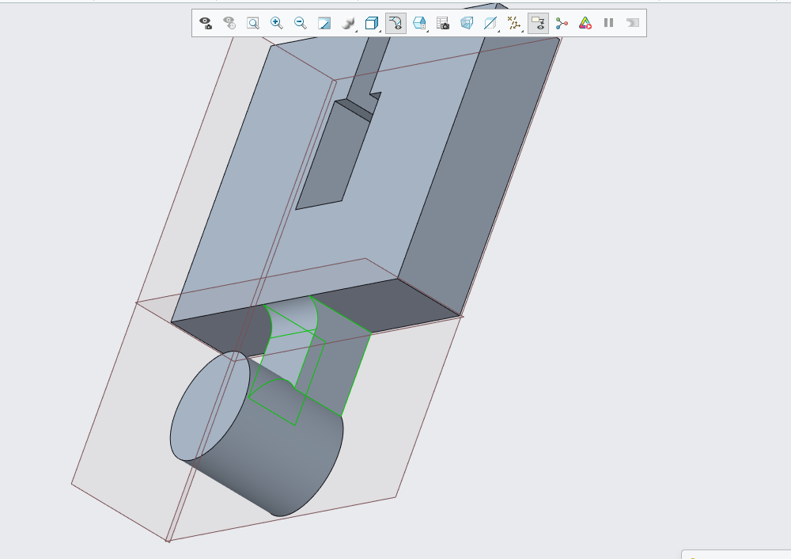
  <figcaption> Showing the new thickness</figcaption>
</figure>

Thankfully these helped and the stress concentration decreased considerably as shown below from the new simulation and the new stress 
concentration. 

<figure>
  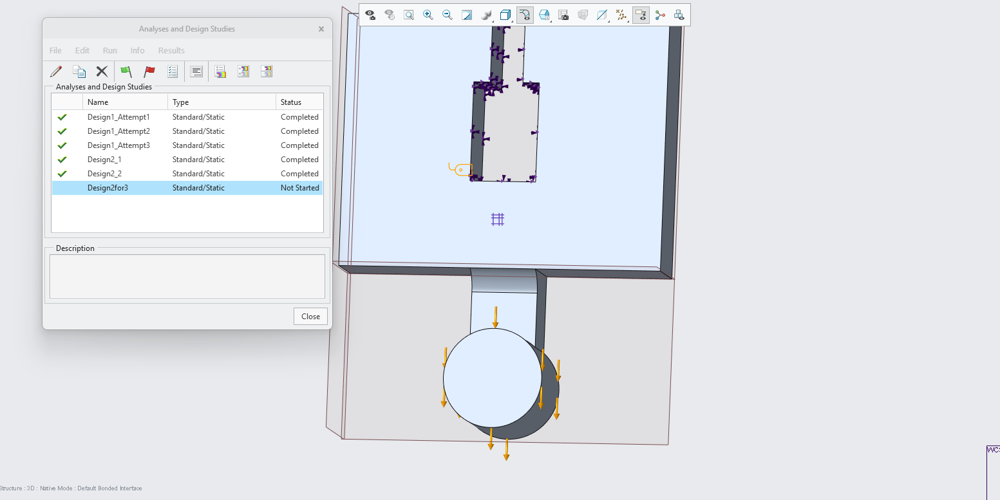
  <figcaption> Showing the last simulation</figcaption>
</figure>

<figure>
  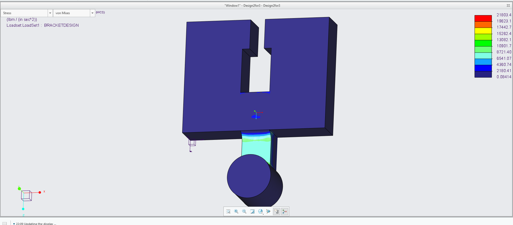
  <figcaption> Showing the last stress</figcaption>
</figure>

## Decide

## Communicate

