# A8 – Gears

## Objective - 

The purpose of this assignment was to create a gear box based on the gears provided, it's important to note the proper clearance. The gearbox has to be able to be
assembled and disassembled as well as have a gear ratio of 24:9. With an output torque of 1.25 in lbf and 1100 rpm relative. Using our machinaries handbook we can
how to design our input and output shafts for gearbox. 

## Shaft Design - 

 Below are a list of the knowns for our input shaft: 

 <ol>
   <li>Output torque = 1.25 in lbf</li>
   <li>Output speed = 1100 rpm</li>
   <li>Output gear tooth = 24</li>
   <li>Input gear tooth = 9</li>
   <li>Input shaft diameter = 0.125</li>
   <li>Input shaft length = 1.0in</li>
   <li>Yield strenght of steel = 40,000 psi </li>
 </ol>

 Leaving our unknowns as follows:

 <ol>
   <li>Our input speed</li>
   <li>our input torque</li>
   <li>Our maximum torsional shear stress</li>
   <li>Safety factor in torsion</li>
 </ol>

## FBD For Input Shaft: 

## Output shaft: 

__knowns__

<ol>
  <li>Torque out is = 1.25 in lbf</li>
  <li>Diameter =0.250 in</li>
  <li>Length = 1.0 in</li>
  <li>Yield strength assumption = 40,000 psi</li>
</ol>

__Uknowns__ 

<ol>
  <li>The max torisonal shear stress</li>
</ol>

## FBD For Output Shaft: 

## Design of Journal Bearing (Sizing, Pressure, Velocity, and PV Rating): 

__knowns__ 

<ol>
  <li>Shaft diameters = 0.125 in and 0.250 in</li>
  <li>Bearing lengths = 0.25 to 0.50</li>
  <li>Speeds = N(in) = 2933.33 rpm and N(out) = 1100 rpm</li>
</ol>

__Unknowns__ 

<ol>
  <li>Projected bearing pressure P, sliding velocity V, and pressure–velocity value PV. The radial load and final bearing length must be specified
    for eachbearing.</li>
</ol>

## FBD OF Journal Bearing 

## Design of Journal Bearing Wall thickness

__knowns__ 

<ol>
  <li>Output bearing inner diameter = 0.250 in </li>
  <li>Proposed Outer Diameter = 0.375 in </li>
  <li>Radial operating - load assumption = 5lbf</li>
</ol>

__Unknowns__

Leaving our only unknown to be, whether the selected wall thickness meets the stress and press-fit requirements. This requires the interference
pressure, material properties, and boundary conditions.

## FBD and stresses: 

## McMaster-Carr Journal-Bearing Selection

## Cad Design -

To start this Cad design I would create the parametric equations using both the dimensions from the gears and what we calculated from our freebody diagrams. 
Parametric equations used was the distance from the center to the center of the two gears, the diameter of where the larger tooth gear would sit, the diameter
of the larget tooth gear itself for the shaft, the diameter of smaller tooth gear, and the diameter of the shaft of the smaller tooth gear. 

<figure>
  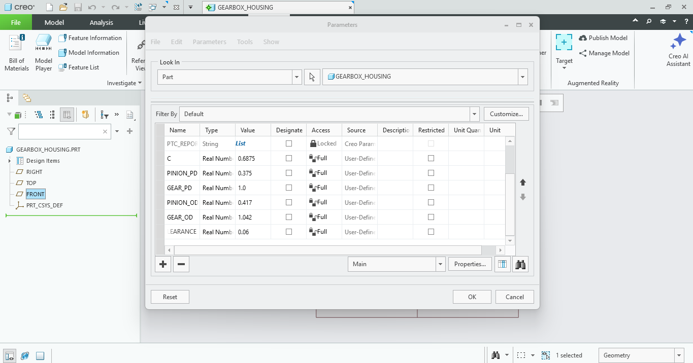
  <figcaption> Showing the parametric equations being created </figcaption>
</figure>

Next, I would create two circles of reference, this will make more sense later but this is where our gears will sit when we fully create the gear box part. 
Since we decided to create a gear box as a part file and split the body into two different pieces it's important we have the reference as shown below. 

<figure>
  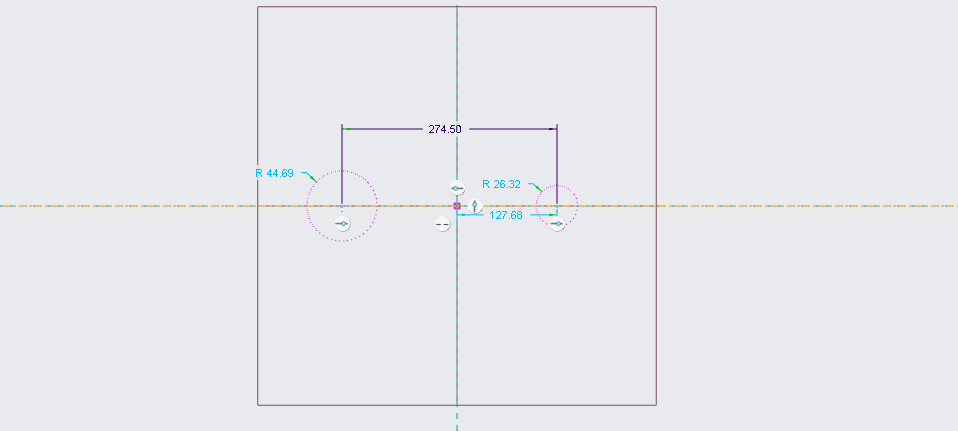
  <figcaption> Showing the references for the two gears in our gear box design.</figcaption>
</figure>

Afterwards, I would change the distance between the two points to be what we calculated as a distance between the two gears. We got this by finding the smaller 
gear and the larger gear adding the diameters between the two and dividing it by two for our center distance between our gears this is our C, in our parameters 
tab. 

<figure>
  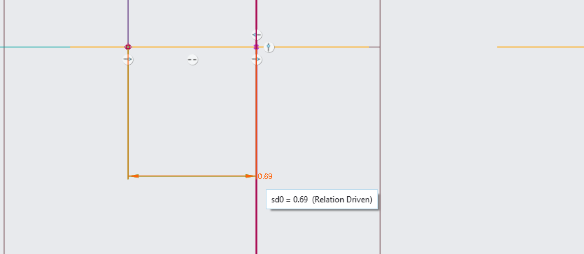
  <figcaption> Showing the reference distance for the two gears in our gear box design.</figcaption>
</figure>

After this I would draw out the circles that represent the gears themselves, its important to have this design and it can be seen below. 

<figure>
  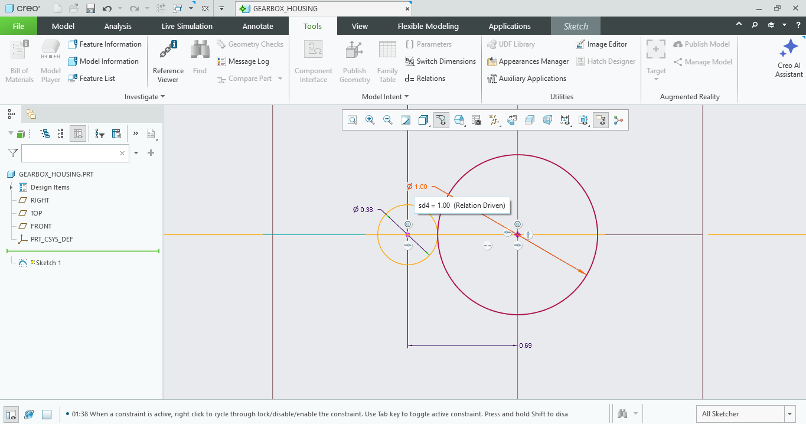
  <figcaption> Showing the reference circles for the two gears in our gear box design.</figcaption>
</figure>

Next, we would close these reference circles as shown below. 

<figure>
  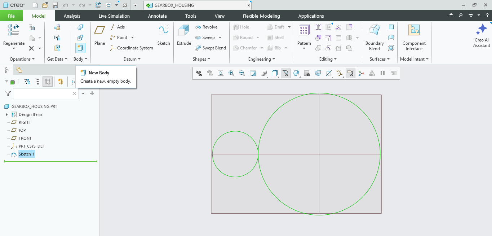
  <figcaption> Showing the reference circles being closed for the two gears in our gear box design.</figcaption>
</figure>

After this we would begin to sketch our gear box design out as shown below we click the sketch menu in the ribbon and select top face. 

<figure>
  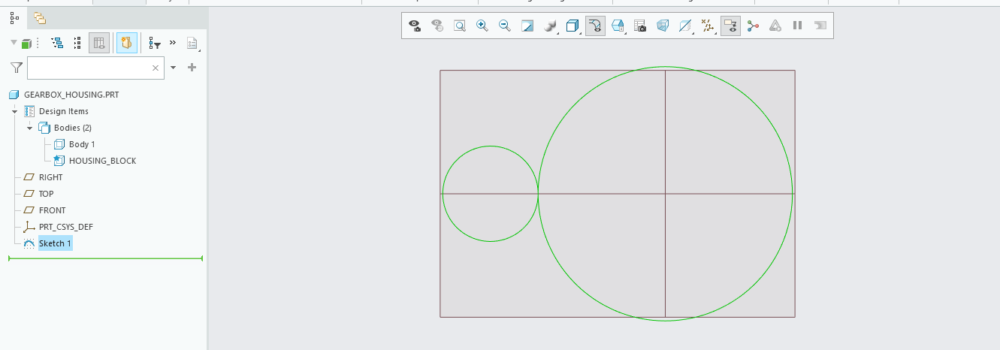
  <figcaption> Showing the start of the sketch.</figcaption>
</figure>

Next we would sketch the body of the box by creating a rectangle to enclose the two gears that we have making sure to leave enough space for the gears to be 
able to safely turn. 

<figure>
  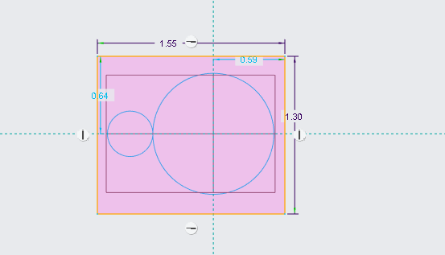
  <figcaption> Showing the rectangle.</figcaption>
</figure>

Then we would extrude this symmetrically so both sides have the same amount of material, which we need for when we split the bodies. 

<figure>
  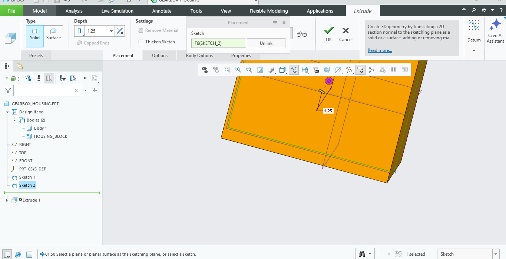
  <figcaption> Showing the extrude.</figcaption>
</figure>

Next, we're making sure the gears diameter is being parametrically modeled for our new design sketch as creo doesn't auto track. 

<figure>
  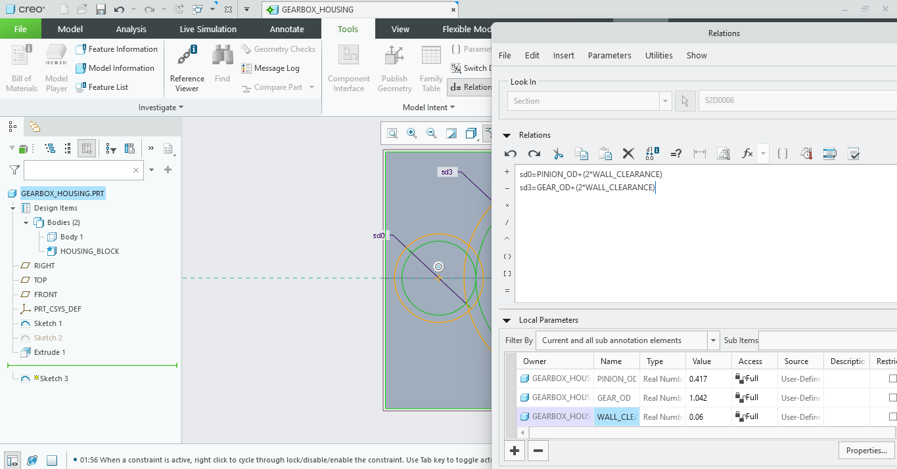
  <figcaption> Showing the diameter.</figcaption>
</figure>

After words I would sketch smaller circles equal to the inner diameters of each gear inside of the larger gear, this is important as it allows us to sit the 
gears somewhere when our bodies do split apart in creo later. 

<figure>
  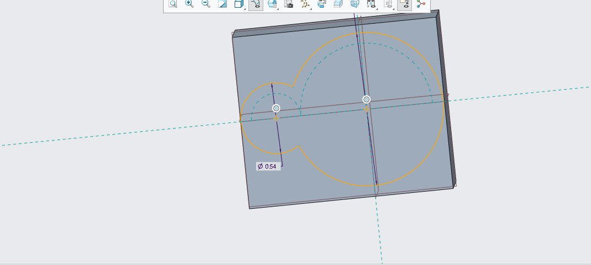
  <figcaption> Showing the sketch.</figcaption>
</figure>

Then this sketch would be extruded to a value of 0.125 as its the height of the gears. 

<figure>
  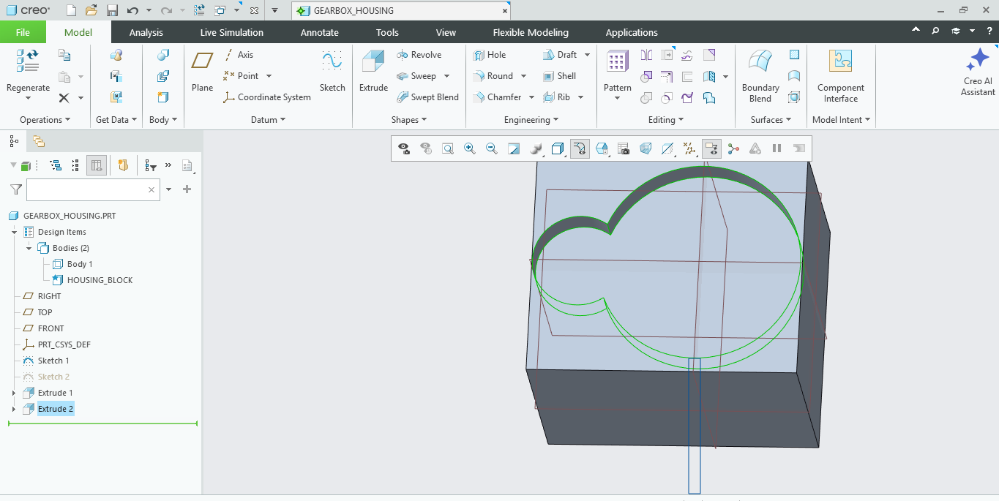
  <figcaption> Showing the second extrude.</figcaption>
</figure>

The next thing I had to do was create the inner diameter again as it was extruded before. 

<figure>
  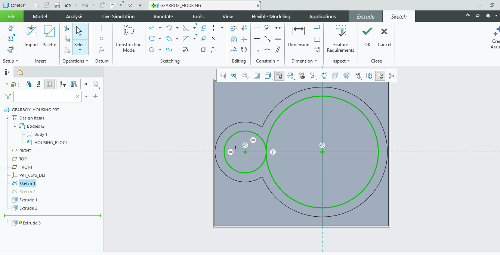
  <figcaption> Showing the second inner diameter.</figcaption>
</figure>

When I was sure this worked I moved onto extruding this entire inner diameter as we need the gears to be able to sit on either side of the body. If I didn't 
extrude here the box wouldn't be able to internally hold the gears. 

<figure>
  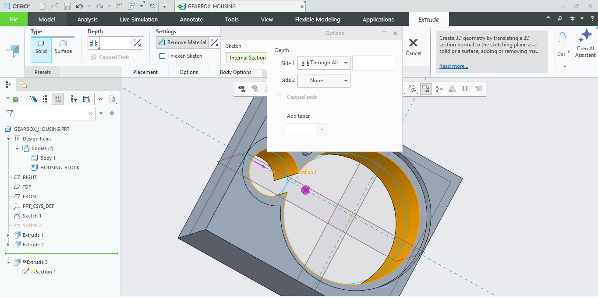
  <figcaption> Showing the extrude.</figcaption>
</figure>

Afterwards I would split the bodies in Creo, I did this so it would be able to be assembled later on, I selected the datum plane I wanted to split on and would
click bodies in the ribbon. 

<figure>
  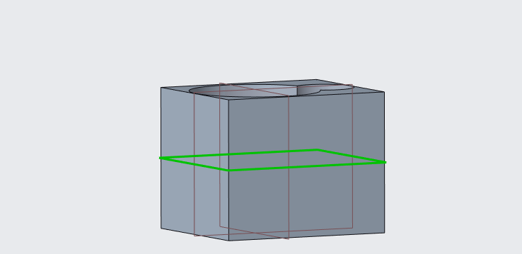
  <figcaption> Showing the spliting bodies in creo.</figcaption>
</figure>

As you can see this body is now two separate pieces as shown below. 

<figure>
  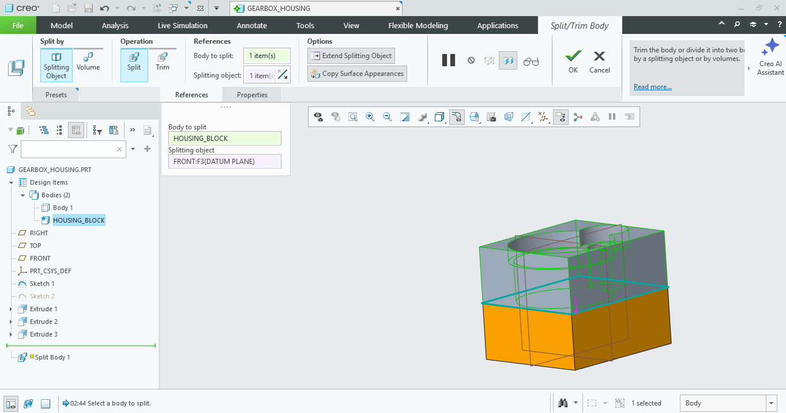
  <figcaption> Showing the spliting bodies in creo.</figcaption>
</figure>

Now since Creo treats different parts anything done to one body is NOT done to the other so I would have to do everything twice from now on, I thought the 
stress could be lowered if I rounded the edges in the bodies so I did that as well as shown below. 

<figure>
  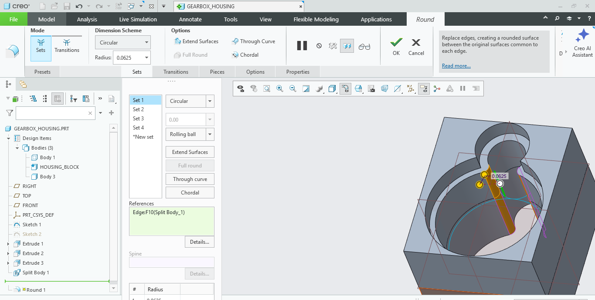
  <figcaption> Showing the rounding bodies in creo.</figcaption>
</figure>

Next I would begin to create the holes for the screws so the parts could be assembled later on as shown below, I had to constrain the hole first. 

<figure>
  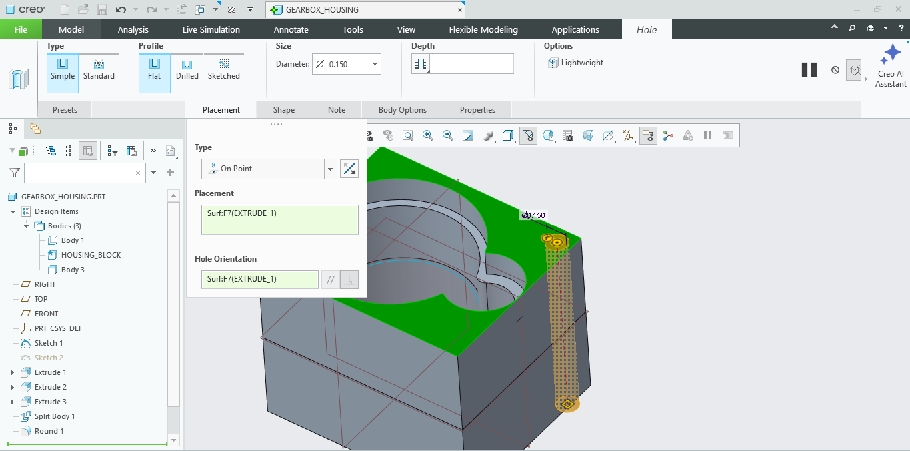
  <figcaption> Showing the holes being constrained.</figcaption>
</figure>

Then I would only have to pattern the hole for the hole to work across all four of the edges of the part as shown below. 

<figure>
  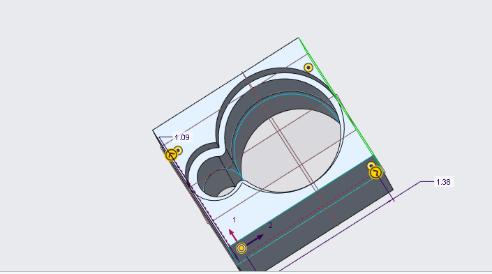
  <figcaption> Showing the holes being constrained.</figcaption>
</figure>

<figure>
  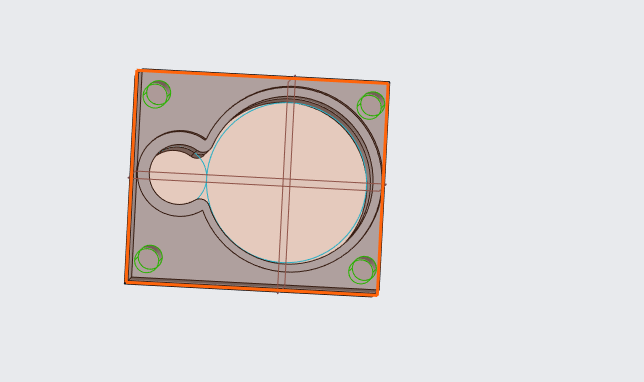
  <figcaption> Showing the holes being constrained.</figcaption>
</figure>

After the holes were fully constrained I could continue onto the next part and gather the gear box to be ready to be assembled with the two other gears as shown
below I opened up a new assembly file in Creo and added the gearbox in first. 

<figure>
  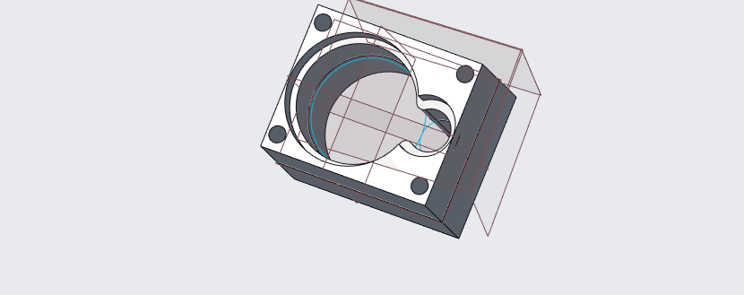
  <figcaption> Showing the new assembly file.</figcaption>
</figure>

After this I added the first gear I wanted to be sure the sizes matched what I modeled for and thankfully they did perfectly. 

<figure>
  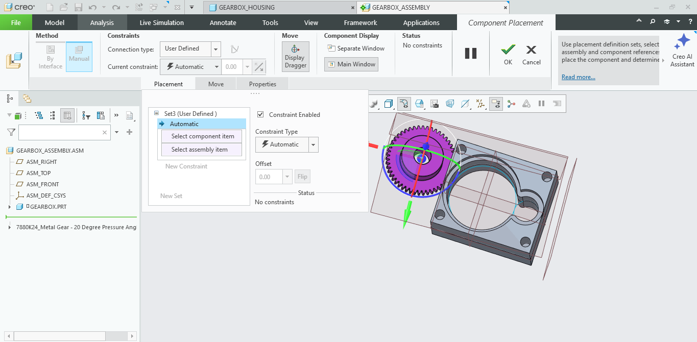
  <figcaption> Showing gear in the new assembly file.</figcaption>
</figure>

Next I would being to constrain the larger gear as shown below, 

<figure>
  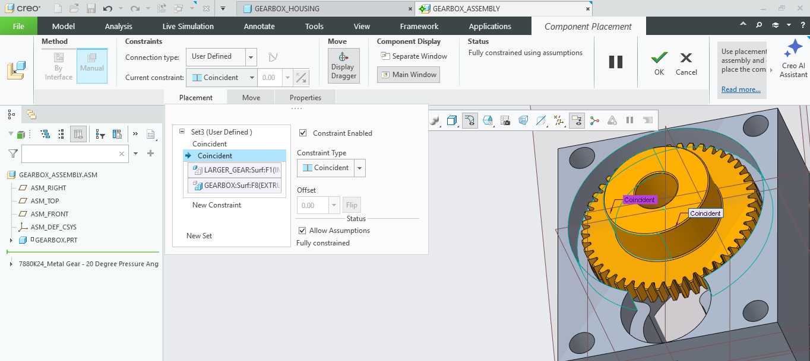
  <figcaption> Showing gear in the new assembly file.</figcaption>
</figure>

After it glows yellow I know it's constrained and ready and I go to the next gear and constrain it the same way. 

<figure>
  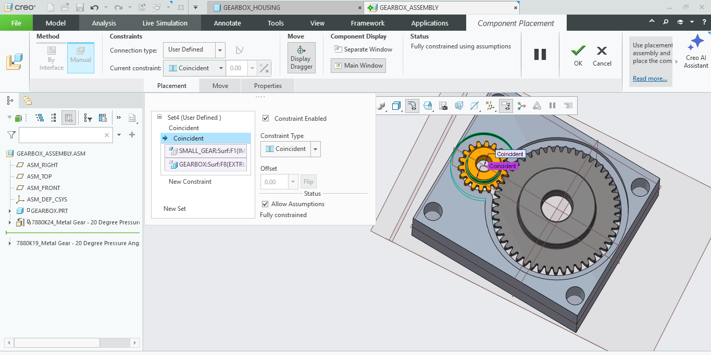
  <figcaption> Showing second gear in the new assembly file.</figcaption>
</figure>

Finally the gear box is done and awaiting screws for it to be fully assembled. 

<figure>
  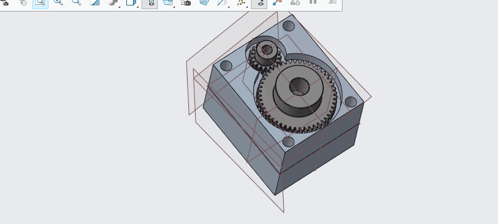
  <figcaption> Showing second gear in the new assembly file.</figcaption>
</figure>

## Analyze

## Decide

## Communicate

