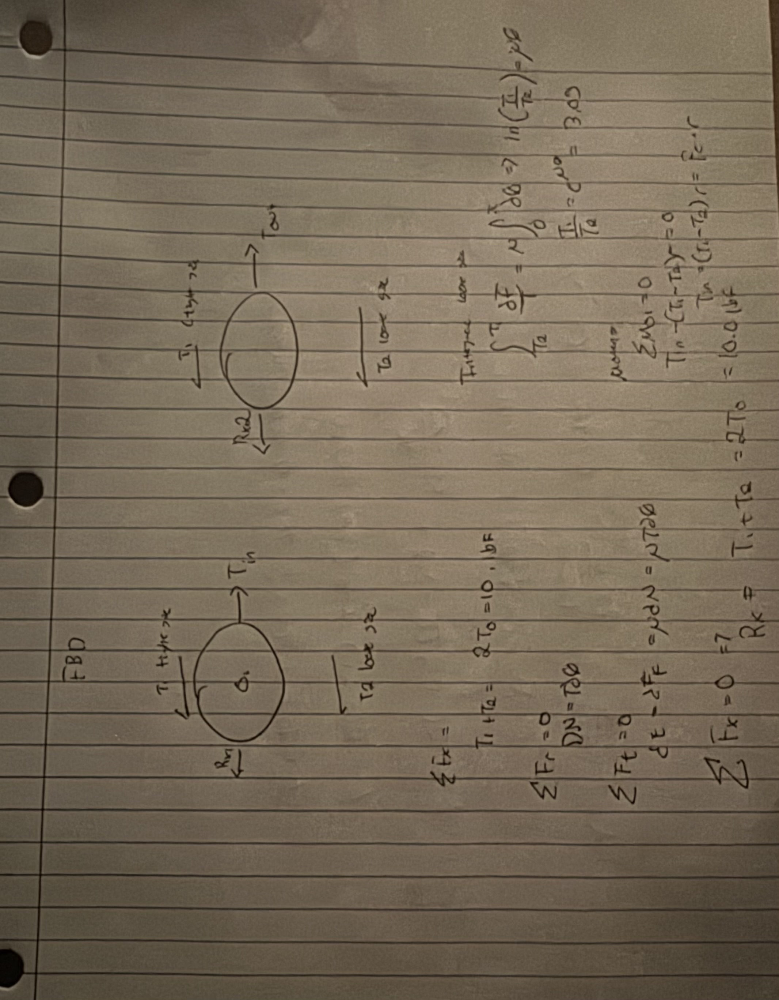
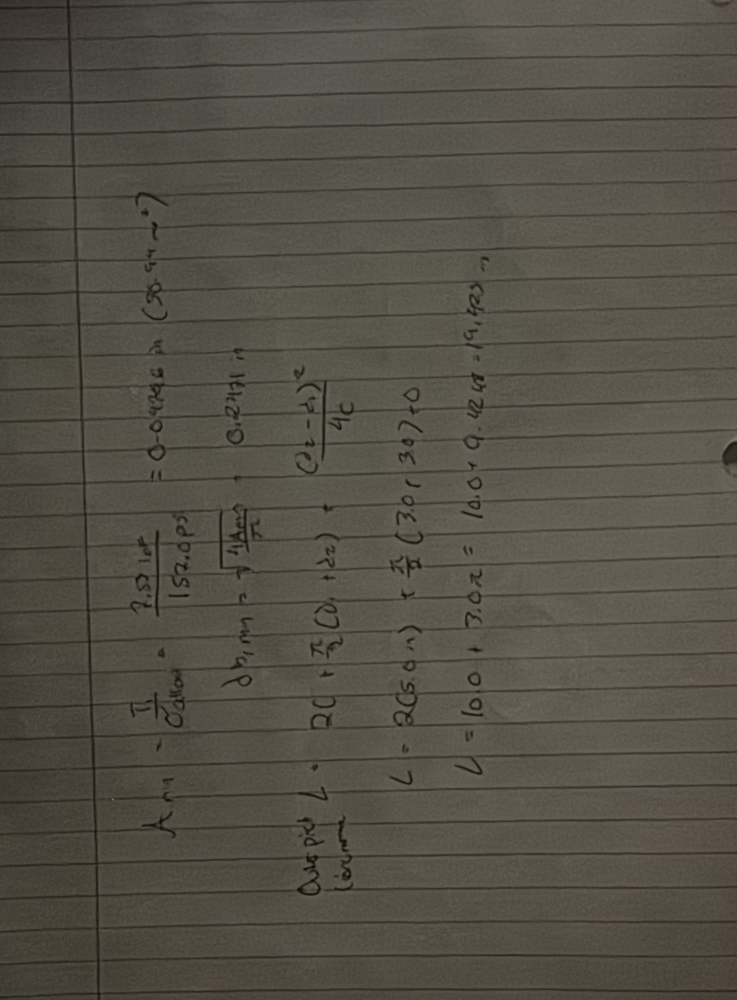
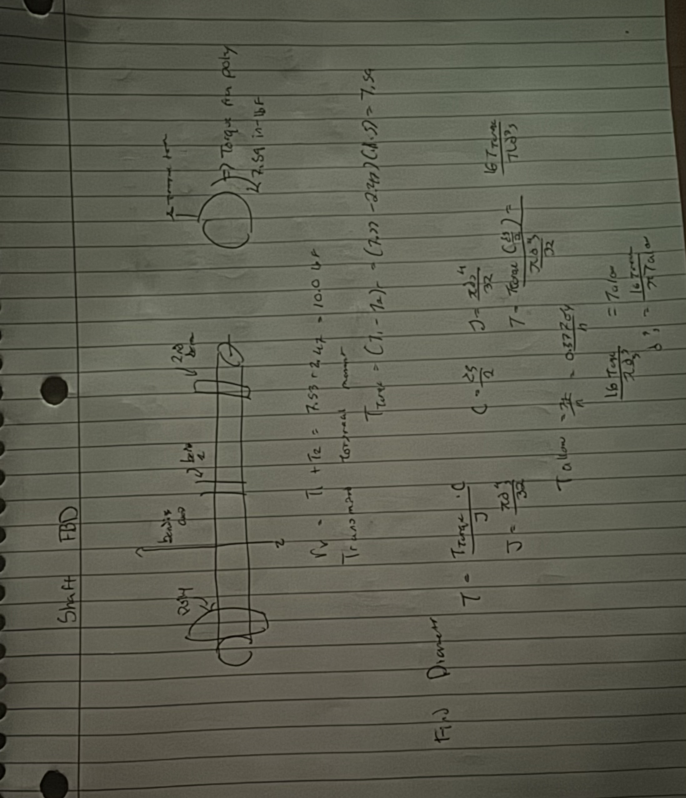
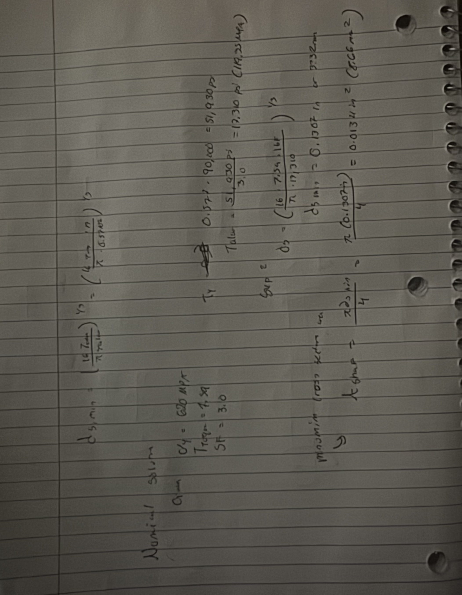

# A9 – Pulleys

## Objective - 

The objective of this assignment is to guiding me through the complete engineering process of conceptualizing, analyzing, and sizing a functioning 
mechanical power transmission system from scratch.

## Belt / Pully system - 

### Unknowns / Knowns 

**Unknows**

<ol>
  <li>Tensional Force on the tight side</li>
  <li>Tensional Force on the loose side</li>
  <li>Force between the pully and the belt</li>
  <li>Torque applied to the shaft</li>
  <li>The cross sectional area of the belt</li>
  <li>The belts cross sectional diameter</li>
  <li>Total belt pitch length</li>
</ol>

**knowns** 

<ol>
  <li> The distance between the center of the pullies can be 5 in</li>
  <li> The diameter of the driver pully is 3 in</li>
  <li> The diameter of the driven pully is also 3 in</li>
  <li> The operating speed of the pully can be 1500 rpm</li>
  <li> The contact wrap angle can be pi rad(180)</li>
  <li> Safety factor is 3</li>
  <li> Static belt tension can be 5 lbf</li>
</ol>

### FBD solving for cross sectional area 

<figure>
  
  <figcaption> This shows the algebric solutions and the freebody diagram of the two pullies in the system.</figcaption>
</figure>

Below is the second part solving for the length and the cross sectional area needed. 

<figure>
  
  <figcaption> This shows the cross sectional area and the length required. </figcaption>
</figure>

## Shaft Design 

### Knowns for shaft : 

<ol>
  <li>The torque on trasmitted through the shaft is 7.59 in per lbf</li>
  <li>The materal chosen was 1060 hardend steel</li>
  <li>The tensile strength of this steel is 90 ksi</li>
  <li>The shear yield strength is 358 mpa</li>
  <li>The safety factor the design is 3</li>
  <li>The bending load is 44.38 N</li>
</ol>

### Unknowns for shaft : 

<ol>
  <li> The allowable stress</li>
  <li> The minimum shaft cross sectional area</li>
  <li> The minimum shaft polar moment of inerta</li>
  <li> The minimum shaft diameter</li>
</ol>

### FBD :

Below is the Freebody diagram for the shaft and the algebraic solutions for the cross sectional area 

<figure>
  
  <figcaption> This shows the cross sectional area and the length required. </figcaption>
</figure>

Below are the numerical solutions for the area and diameter. 

<figure>
  
  <figcaption> This shows the cross sectional area and the length required. </figcaption>
</figure>

## Journal Bearing : 

### Knowns : 

<ol>
  <li> Shaft Radial Load = 44.48 N </li>
  <li> Shaft Rotaional Speed = 1500 rpm</li>
  <li> Nominal journal / Shaft diameter = 0.500 in</li>
  <li> Bearing Nominal Length  = 0.500 in</li>
  <li> Safety factor = 3</li>
</ol>

### Unknowns : 

<ol>
  <li> Projected Bearing Area</li>
  <li> Bearing Unit Pressure</li>
  <li> Linear Surface sliding Velocity</li>
  <li> Operating PV Factor</li>
  <li> Suitable Bearing material</li>
</ol>

### FBD : 

Below is the Freebody diagram and the algebraic modeling. 

<figure>
  
  <figcaption> This shows the Freebody diagram 
</figure>

Below is the numerical solutions. 

<figure>
  
  <figcaption> This shows the numerical solutions
</figure>

## Engineering analysis 

### Key Parameters:
* **Center Distance (C):** 5.0 in 
* **Frame Overall Length (L):** 8.0 in
* **Total Transverse Belt Load F:**
  F_total = T_1 + T_2 = 7.53 lbf + 2.47lbf = 10.0lbf 
* **Frame Material:** 6061-T6 Aluminum Structural C-Channel
  * Tensile Yield Strength sigma_y: 40,000 psi 
  * Shear Yield Strength tau_y: 23,000psi
  * Modulus of Elasticity E: 10.0 \times 10^6 psi
  * Density rho: 0.098lb/in^3

---

## 2. Structural Loading & Bending Stress Analysis

Each shaft is supported at both ends by pillow block journal bearings mounted to two parallel side rails. The $10.0\text{ lbf}$ belt tension load acts at the midpoint between bearing supports L = 8.0 in:

Load per side rail P_side = F_total = 2  
10.0 lbf/ 2 = 5.0lbf

### Maximum Bending Moment M_max
Modeling the side rails as simply supported beams with a concentrated central point load:

M_max = P_side/4 = 5.0 lbf 

### Cross-Section Properties (1.0" x 0.5" x 0.125" Wall C-Channel)
* Flange Width (b): 0.50 in
* Total Depth (h): 1.00 in
* Web/Flange Thickness (t): 0.125 in
* Moment of Inertia (I_x): 0.0182 in^4
* Section Modulus (S_x) = I_x/c: 0.0364 in^3 c = 0.50 in

### Maximum Bending Stress (Sigma_max)
sigma_max = M_max/ S_x = 10.0in-lbf/ 0.0364 in^3 = 274.7 psi

### Structural Safety Factor (n)
n = sigma_y/sigma_max =40,000 psi/274.7 psi = 145.6 psi

---

## 3. Deflection & Angular Alignment Verification

 SAE 841 journal bearing interface, mid-span deflection delta_max must remain below 0.001 in 

### Maximum Deflection Calculation
delta_max=  L^3/48 E I_x

Substituting operational parameters:
delta_max = 5.0 lbf/8.0 in^3 = 48 (10.0 * 10^6 psi)(0.0182 in^4) = 2,560/8,736,000 = 0.000293 in 

delta_max = 0.000293 in  >  0.001000 in} 

### Support Angular Misalignment Slope (theta_end)
theta_end = P_side/c L^2/ 16 E I_x = (5.0)/(8.0)^2 = 16 (10.0 * 10^6)(0.0182) = 0.00011 radians

An angular deflection slope of 0.0011 radians ensures uniform load distribution along the journal bearing matrix without stress concentration at the edges.

## Lessons Learned 

<ol>
  <li> Torsional shear stress calculations for small-diameter shafts often yield mathematically tiny diameters, but practical engineering as like those 
    those described in the handbook requires sizing shafts based on combined bending and torsional fatigue loads as well as standard bearing journal
    dimensioning</li>

  <li>How to use bearing operating parameters to find materials needed in a design such as, SAE 932 bronze which we knew provides exceptional safety margins 
    for low-load, moderate-speed power transmission assemblies.</li>
</ol>

## Total Time taken 

<ul>
  <li>Hand calculations using the book as reference = 10 hours </li>
  <li>Searching for materials to be used in the design = 1 hour based on the resource provided in canvas</li>
  <li>Putting work into github = 2 hours</li>
  <li>Total Time spent = 13 hours</li>
</ul>

